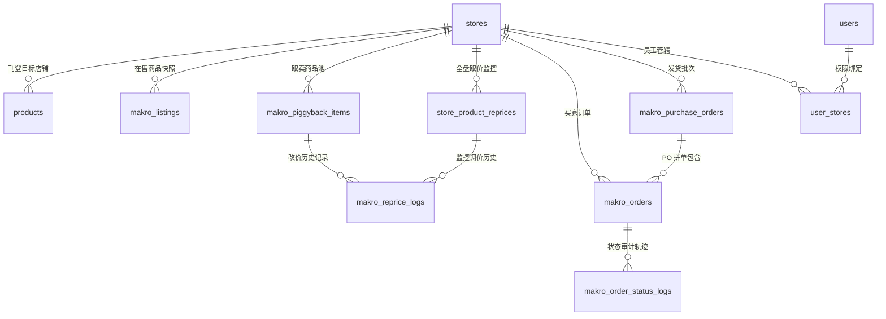
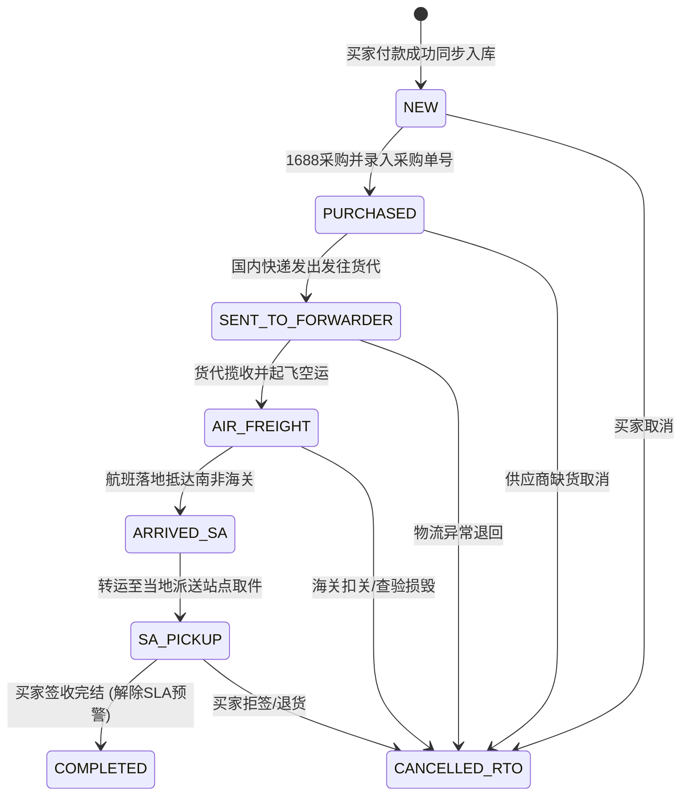
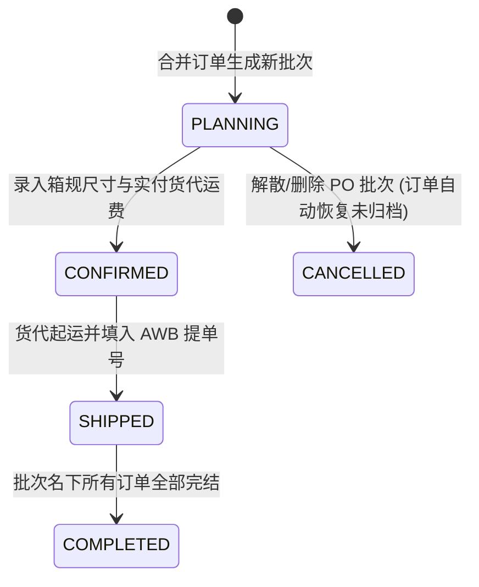
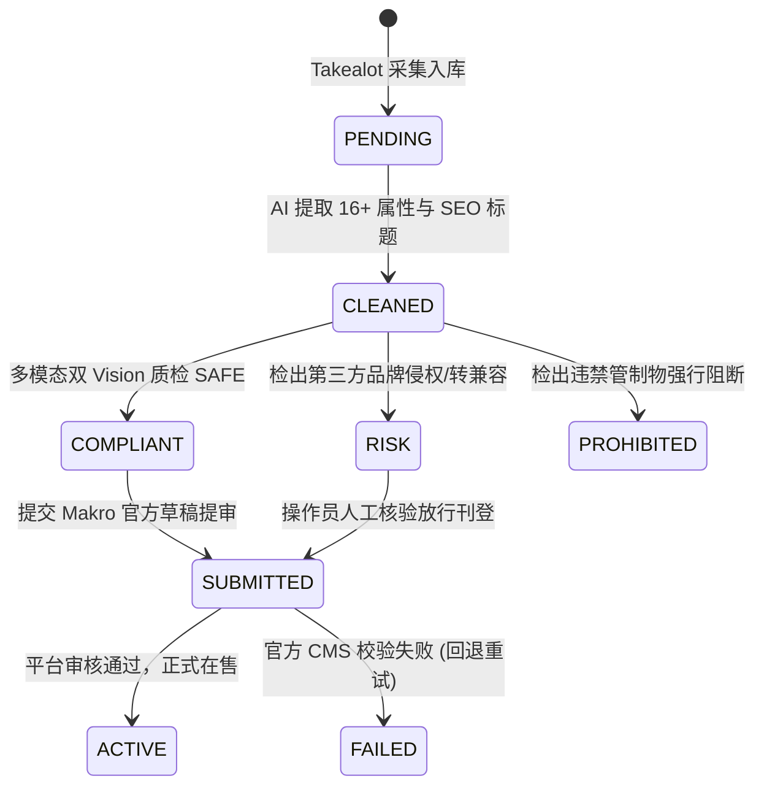

# Makro-Takealot 智能运营系统 - 数据库模型与核心业务字典 (v2.3.0)

> **文档定位**：专为系统架构师、后端开发人员及运维技术人员编写。详尽记录系统全量 12 张核心数据库表的 DDL 字段规范、主外键拓扑关系、4 大业务状态机字典流转图及核心财务对账算法。

---

## 📑 目录

- [一、数据库全景拓扑图 (ER Diagram)](#一数据库全景拓扑图-er-diagram)
- [二、全量数据表结构与字段字典 (12 张核心表)](#二全量数据表结构与字段字典-12-张核心表)
  - [1. `stores` - 多店铺矩阵与凭据配置表](#1-stores---多店铺矩阵与凭据配置表)
  - [2. `products` - Takealot 选品与刊登主表](#2-products---takealot-选品与刊登主表)
  - [3. `makro_listings` - Makro 官方在售商品快照表](#3-makro_listings---makro-官方在售商品快照表)
  - [4. `makro_piggyback_items` - 智能跟卖池商品表](#4-makro_piggyback_items---智能跟卖池商品表)
  - [5. `store_product_reprices` - 全盘跟价监控与巡航状态表](#5-store_product_reprices---全盘跟价监控与巡航状态表)
  - [6. `makro_reprice_logs` - BuyBox 动态改价流水审计表](#6-makro_reprice_logs---buybox-动态改价流水审计表)
  - [7. `makro_orders` - 全生命周期订单履约主表](#7-makro_orders---全生命周期订单履约主表)
  - [8. `makro_purchase_orders` - PO 空运拼单批次总账表](#8-makro_purchase_orders---po-空运拼单批次总账表)
  - [9. `makro_order_status_logs` - 订单流转与操作审计日志表](#9-makro_order_status_logs---订单流转与操作审计日志表)
  - [10. `system_settings` - 系统全局参数配置表](#10-system_settings---系统全局参数配置表)
  - [11. `users` - RBAC 用户与员工账号表](#11-users---rbac-用户与员工账号表)
  - [12. `user_stores` - 员工店铺管辖权关联表](#12-user_stores---员工店铺管辖权关联表)
- [三、核心业务状态机字典与流转图](#三核心业务状态机字典与流转图)
  - [1. 订单 7 阶履约状态机](#1-订单-7-阶履约状态机)
  - [2. PO 空运拼单批次状态机](#2-po-空运拼单批次状态机)
  - [3. BuyBox 竞价与跟卖状态机](#3-buybox-竞价与跟卖状态机)
  - [4. AI 清洗与合规质检状态机](#4-ai-清洗与合规质检状态机)
- [四、核心业务计算模型与对账算法](#四核心业务计算模型与对账算法)

---

## 一、数据库全景拓扑图 (ER Diagram)



---

## 二、全量数据表结构与字段字典 (12 张核心表)

### 1. `stores` - 多店铺矩阵与凭据配置表
用于管理多个 Makro 官方店铺的会话认证、自动登录保活凭据及默认刊登品牌配置。

| 字段名 | 类型 | 约束 | 默认值 | 业务含义与说明 |
| :--- | :--- | :--- | :--- | :--- |
| `id` | INTEGER | PK, AI | - | 店铺唯一自增主键 |
| `name` | VARCHAR(100) | NOT NULL | - | 店铺别名（如“Makro 旗舰店”、“hzh”） |
| `seller_id` | VARCHAR(50) | NOT NULL, INDEX | - | Makro 官方 16 位十六进制店铺 ID |
| `email` | VARCHAR(150) | NULL | - | 店铺登录账号绑定的邮箱地址 |
| `email_password` | VARCHAR(255) | NULL | - | 邮箱 IMAP 授权访问密码（用于提取登录 OTP） |
| `imap_server` | VARCHAR(100) | NULL | - | IMAP 服务器地址（如 `imap.gmail.com`） |
| `imap_port` | INTEGER | NULL | 993 | IMAP SSL 连接端口 |
| `login_url` | VARCHAR(255) | NULL | - | 卖家后台自动登录入口链接 |
| `login_status` | VARCHAR(50) | NULL | 'ACTIVE' | 保活状态：`ACTIVE`（正常）, `EXPIRED`（失效）, `ERROR` |
| `last_login_at` | DATETIME | NULL | - | 上次成功执行自动登录刷新的时间 |
| `raw_cookies` | TEXT | NULL | - | 当前有效的会话 Cookie 字符串 |
| `fk_csrf_token` | VARCHAR(255) | NULL | - | 当前有效的 Makro CSRF 防伪令牌 |
| `default_brand` | VARCHAR(100) | NULL | 'Beishi' | 店铺刊登默认使用的自有白牌名称 |
| `is_active` | BOOLEAN | NULL | 1 | 店铺是否启用 |
| `is_default` | BOOLEAN | NULL | 0 | 是否为系统默认主店铺 |
| `created_at` | DATETIME | NULL | CURRENT_TIMESTAMP | 创建时间 |
| `updated_at` | DATETIME | NULL | CURRENT_TIMESTAMP | 更新时间 |

---

### 2. `products` - Takealot 选品与刊登主表
存储自 Takealot 采集的原生商品多变体、AI 清洗结果、质检合规标签及发布到 Makro 的草稿状态。

| 字段名 | 类型 | 约束 | 默认值 | 业务含义与说明 |
| :--- | :--- | :--- | :--- | :--- |
| `id` | INTEGER | PK, AI | - | 自增主键 |
| `plid` | VARCHAR(50) | NOT NULL, INDEX | - | Takealot 官方商品唯一产品线标识 (PLID) |
| `tsin_id` | VARCHAR(50) | NULL | - | Takealot 官方变体 TSIN ID |
| `title` | VARCHAR(500) | NOT NULL | - | Takealot 原版英文标题 |
| `cleaned_title` | VARCHAR(500) | NULL | - | AI 规范化重塑后的 SEO 英文标题 |
| `takealot_title_zh` | VARCHAR(500) | NULL | - | 标题中文翻译快照 |
| `makro_title_zh` | VARCHAR(500) | NULL | - | 刊登标题中文对照 |
| `seo_keywords` | TEXT | NULL | - | AI 提取的英文 SEO 关键词集合 |
| `status` | VARCHAR(50) | NULL, INDEX | 'PENDING' | 清洗与发布生命周期状态（详见状态机字典） |
| `previous_status` | VARCHAR(50) | NULL | - | 状态回滚暂存前置状态 |
| `clean_mode` | VARCHAR(20) | NULL | 'text' | 清洗模式：`text`（纯文本），`vision`（图文多模态） |
| `brand` | VARCHAR(100) | NULL | - | 原品牌名称 |
| `model_number` | VARCHAR(100) | NULL | - | 清洗后去品牌化的型号 Model Number |
| `category` | VARCHAR(100) | NULL | - | Takealot 分类层级 |
| `vertical` | VARCHAR(100) | NULL | - | 映射对应的 Makro 400+ 底层 Vertical 编码 |
| `selling_price` | FLOAT | NULL | - | Takealot 原售价 (ZAR) |
| `mrp` | FLOAT | NULL | - | Takealot 划线参考原价 (ZAR) |
| `makro_price` | FLOAT | NULL | - | 测算得出的拟发布到 Makro 的最终售价 (ZAR) |
| `makro_mrp` | FLOAT | NULL | - | 拟发布的划线展示价 (ZAR) |
| `images` | TEXT | NULL | - | Takealot 原始图链数组 (JSON 序列化) |
| `cdn_images` | TEXT | NULL | - | 转存至 Makro 官方 CDN 后的图链数组 (JSON) |
| `attributes` | TEXT | NULL | - | AI 抽取的 16+ 项严苛 CMS 属性键值对 (JSON) |
| `compliance_status` | VARCHAR(50) | NULL | 'PENDING' | 合规风控结论：`SAFE`, `RISK`, `PROHIBITED` |
| `compliance_reason` | TEXT | NULL | - | 违禁或品牌侵权的具体风控拦截原因说明 |
| `store_id` | INTEGER | FK -> stores.id | - | 指定发布的 Makro 店铺 ID |
| `draft_id` | VARCHAR(100) | NULL | - | Makro 平台草稿 Draft ID |
| `request_id` | VARCHAR(100) | NULL | - | Makro 异步提交任务 Request ID |
| `publish_error` | TEXT | NULL | - | 官方上架提审失败返回的底层详细报错报文 |
| `variants_json` | TEXT | NULL | - | 异构多变体（多尺码/颜色/容量）全量数据 (JSON) |
| `created_at` | DATETIME | NULL | CURRENT_TIMESTAMP | 入库时间 |
| `updated_at` | DATETIME | NULL | CURRENT_TIMESTAMP | 更新时间 |

---

### 3. `makro_listings` - Makro 官方在售商品快照表
后台每 30 分钟同步一次官方店铺的已在线 Listing 状态，用于跟卖挂靠与库存对齐。

| 字段名 | 类型 | 约束 | 默认值 | 业务含义与说明 |
| :--- | :--- | :--- | :--- | :--- |
| `id` | INTEGER | PK, AI | - | 自增主键 |
| `store_id` | INTEGER | FK -> stores.id, INDEX | - | 归属店铺 ID |
| `sku_id` | VARCHAR(100) | NOT NULL, INDEX | - | 本店在售 SKU |
| `product_id` | VARCHAR(100) | NULL, INDEX | - | Makro 平台全局产品 FSN / Product ID |
| `listing_status` | VARCHAR(50) | NULL | 'ACTIVE' | 官方在线状态：`ACTIVE`（在售）, `INACTIVE` |
| `title` | VARCHAR(500) | NULL | - | 官方前台展示标题 |
| `mrp` | FLOAT | NULL | - | 划线参考原价 |
| `selling_price` | FLOAT | NULL | - | 当前前台销售价格 (ZAR) |
| `stock` | INTEGER | NULL | 0 | 当前可用仓库库存件数 |
| `weight` | FLOAT | NULL | - | 官方录入重量 (kg) |
| `synced_at` | DATETIME | NULL | CURRENT_TIMESTAMP | 最近同步时间 |

---

### 4. `makro_piggyback_items` - 智能跟卖池商品表
管理系统跟卖竞品池，包括竞品底价、保本底线、抢车跟价策略及 7 大 KPI 判定。

| 字段名 | 类型 | 约束 | 默认值 | 业务含义与说明 |
| :--- | :--- | :--- | :--- | :--- |
| `id` | INTEGER | PK, AI | - | 自增主键 |
| `store_id` | INTEGER | FK -> stores.id | - | 执行跟卖的本店 ID |
| `item_id` | VARCHAR(100) | NOT NULL, INDEX | - | 竞品详情唯一 Item ID |
| `makro_product_id` | VARCHAR(100) | NULL | - | Makro 平台全局 FSN / 产品 ID |
| `seller_sku` | VARCHAR(100) | NULL | - | 本店挂靠生成的 Seller SKU |
| `title` | VARCHAR(500) | NULL | - | 竞品商品标题 |
| `competitor_seller_name` | VARCHAR(150) | NULL | - | 当前 BuyBox 持有竞对卖家名称 |
| `competitor_price` | FLOAT | NULL | - | 竞对当前最低报价 (ZAR) |
| `target_price` | FLOAT | NULL | - | 本店计划调整的目标推售价格 (ZAR) |
| `floor_price` | FLOAT | NULL | - | 保本底价 (ZAR)，低于此价格坚决不降 |
| `cost_cny` | FLOAT | NULL | - | 1688 采购成本价 (RMB) |
| `weight` | FLOAT | NULL | - | 单件商品毛重 (kg) |
| `strategy` | VARCHAR(50) | NULL | 'MINUS_1' | 跟价策略：`MINUS_1`, `MATCH`, `PERCENT_OFF` |
| `status` | VARCHAR(50) | NULL, INDEX | 'PENDING' | 跟卖池状态机（详见下文） |
| `retry_reason` | VARCHAR(255) | NULL | - | 三轨独立重试故障归因 |
| `last_scraped_at` | DATETIME | NULL | - | 上次爬虫拟真抓取竞品价格时间 |
| `created_at` | DATETIME | NULL | CURRENT_TIMESTAMP | 创建时间 |
| `updated_at` | DATETIME | NULL | CURRENT_TIMESTAMP | 更新时间 |

---

### 5. `store_product_reprices` - 全盘跟价监控与巡航状态表
为全盘所有在售商品构建独立监控行，支持 24 小时无人值守全盘改价巡航。

| 字段名 | 类型 | 约束 | 默认值 | 业务含义与说明 |
| :--- | :--- | :--- | :--- | :--- |
| `id` | INTEGER | PK, AI | - | 自增主键 |
| `store_id` | INTEGER | FK -> stores.id, INDEX | - | 店铺 ID |
| `sku_id` | VARCHAR(100) | NOT NULL, INDEX | - | 本店在售 SKU |
| `fsn` | VARCHAR(100) | NULL, INDEX | - | Makro 平台产品唯一 FSN |
| `my_price` | FLOAT | NULL | - | 本店当前在售价格 (ZAR) |
| `target_price` | FLOAT | NULL | - | 巡检策略建议推价 (ZAR) |
| `floor_price` | FLOAT | NULL | - | 保本安全底价 (ZAR) |
| `winning_price` | FLOAT | NULL | - | 当前 BuyBox 获胜价格 (ZAR) |
| `winning_seller` | VARCHAR(150) | NULL | - | 当前 BuyBox 卖家名称 |
| `is_winning` | BOOLEAN | NULL | 0 | 本店是否持有 BuyBox 黄金购物车 |
| `is_exclusive` | BOOLEAN | NULL | 0 | 是否为全网独家在售（无外部竞品跟卖） |
| `competitor_count` | INTEGER | NULL | 0 | 外部参与竞争的卖家总数 |
| `status` | VARCHAR(50) | NULL | 'ACTIVE' | 监控状态：`ACTIVE`, `PAUSED`, `FLOOR_HIT` |
| `last_checked_at` | DATETIME | NULL | - | 最近巡查时间 |
| `updated_at` | DATETIME | NULL | CURRENT_TIMESTAMP | 更新时间 |

---

### 6. `makro_reprice_logs` - BuyBox 动态改价流水审计表
记录系统改价巡航引擎触发的每一次价格变动明细。

| 字段名 | 类型 | 约束 | 默认值 | 业务含义与说明 |
| :--- | :--- | :--- | :--- | :--- |
| `id` | INTEGER | PK, AI | - | 自增主键 |
| `store_id` | INTEGER | FK -> stores.id | - | 店铺 ID |
| `item_id` | INTEGER | NULL | - | 关联跟卖商品 ID |
| `seller_sku` | VARCHAR(100) | NOT NULL, INDEX | - | 调价 SKU |
| `old_price` | FLOAT | NOT NULL | - | 调价前原售价 (ZAR) |
| `new_price` | FLOAT | NOT NULL | - | 调价后新售价 (ZAR) |
| `competitor_price` | FLOAT | NULL | - | 当时触发调价的外部竞对最低价 (ZAR) |
| `trigger_reason` | VARCHAR(255) | NULL | - | 触发动作原因（如 `BEAT_COMPETITOR_MINUS_1`） |
| `success` | BOOLEAN | NULL | 1 | 是否成功推送 Makro 官方生效 |
| `created_at` | DATETIME | NULL | CURRENT_TIMESTAMP | 改价执行时间 |

---

### 7. `makro_orders` - 全生命周期订单履约主表
记录从 Makro 官方抓取入库的买家订单，涵盖 7 阶履约状态、单单称重核算、PO 拼单归档、打单追踪及全链路成本利润。

| 字段名 | 类型 | 约束 | 默认值 | 业务含义与说明 |
| :--- | :--- | :--- | :--- | :--- |
| `id` | INTEGER | PK, AI | - | 内部订单主键 ID |
| `store_id` | INTEGER | FK -> stores.id, INDEX | - | 订单归属店铺 ID |
| `seller_id` | VARCHAR(50) | NOT NULL | - | 店铺 Seller ID |
| `order_id` | VARCHAR(100) | NOT NULL, INDEX | - | Makro 官方买家订单号 (如 `OD438...`) |
| `shipment_id` | VARCHAR(100) | NULL, INDEX | - | Makro 官方运单包裹号 |
| `status` | VARCHAR(50) | NOT NULL | - | 官方原生状态 (`pending_rtd`, `delivered` 等) |
| `fulfillment_status` | VARCHAR(50) | NULL, INDEX | 'NEW' | **系统运营视角 7 阶履约状态**（详见状态机） |
| `fulfillment_updated_at` | DATETIME | NULL | - | 7 阶状态最近变更时间 |
| `po_id` | INTEGER | FK -> makro_purchase_orders.id | - | 关联归档的 PO 空运拼单批次 ID |
| `total_amount` | FLOAT | NULL | 0.0 | 全单销售总额 (ZAR) |
| `currency` | VARCHAR(10) | NULL | 'ZAR' | 结算币种 |
| `order_date` | DATETIME | NULL, INDEX | - | 出单时间（**已规整为北京时间 UTC+8**） |
| `dispatch_by_date` | DATETIME | NULL | - | 平台承诺最晚发货截止时间 (北京时间) |
| `delivered_date` | DATETIME | NULL, INDEX | - | 买家最终签收送达时间 (北京时间) |
| `is_sla_breached` | BOOLEAN | NULL, INDEX | 0 | 是否已超时超期 (SLA 监控预警) |
| `buyer_name` | VARCHAR(150) | NULL | - | 买家姓名 |
| `shipping_city` | VARCHAR(100) | NULL | - | 南非收件城市 |
| `shipping_address_line1`| VARCHAR(255) | NULL | - | 收件地址行 1 |
| `tracking_id` | VARCHAR(100) | NULL | - | 南非当地官方末端派送运单号 |
| `total_weight_g` | INTEGER | NULL | 0 | 订单整单实测总克重 (单位: 克 g) |
| `is_weight_measured` | BOOLEAN | NULL, INDEX | 0 | **是否已实测称重**：`0` 未填写, `1` 已填写 |
| `air_freight_rate` | FLOAT | NULL | 0.0 | 单单独立空运单价 (元/kg，0 为使用系统默认) |
| `purchase_cost` | FLOAT | NULL | 0.0 | 1688 国内采购成本总额 (RMB) |
| `purchase_order_sn` | VARCHAR(100) | NULL | - | 1688 采购单号 / 供货商单号 |
| `purchase_notes` | VARCHAR(255) | NULL | - | 采购规格说明 / 供应商备注 |
| `domestic_tracking_no` | VARCHAR(100) | NULL | - | 国内寄往货代仓库的快递单号 |
| `domestic_logistics_fee`| FLOAT | NULL | 0.0 | 平摊所得的国内快递运费 (RMB) |
| `independent_head_haul` | FLOAT | NULL | 0.0 | 该单按克重核算的理论头程空运费 (RMB) |
| `label_printed` | BOOLEAN | NULL, INDEX | 0 | **是否已打印 40×30mm 热敏打包标签** |
| `label_printed_at` | DATETIME | NULL | - | 首次打印防混标签的时间 (北京时间) |
| `raw_items_json` | TEXT | NULL | - | 订单各商品明细快照 (含单价/小计/图片/SKU) |
| `created_at` | DATETIME | NULL | CURRENT_TIMESTAMP | 创建时间 |
| `updated_at` | DATETIME | NULL | CURRENT_TIMESTAMP | 更新时间 |

---

### 8. `makro_purchase_orders` - PO 空运拼单批次总账表
管理多个订单合并发运的 PO 空运批次、箱规外包装尺寸、实付货代账单与对账利润核算。

| 字段名 | 类型 | 约束 | 默认值 | 业务含义与说明 |
| :--- | :--- | :--- | :--- | :--- |
| `id` | INTEGER | PK, AI | - | PO 批次主键 ID |
| `po_number` | VARCHAR(100) | NOT NULL, UNIQUE | - | 批次业务编号（如 `PO261015-987`） |
| `store_id` | INTEGER | NULL | - | 归属店铺 ID |
| `name` | VARCHAR(200) | NULL | - | 批次名称（如“10月15日南非空运拼单”） |
| `status` | VARCHAR(50) | NULL | 'PLANNING' | 批次状态（`PLANNING`, `SHIPPED`, `COMPLETED`） |
| `forwarder_name` | VARCHAR(100) | NULL | - | 合作空运货代物流公司名称 |
| `air_waybill_no` | VARCHAR(100) | NULL | - | 国际空运主提单号 (AWB) |
| `domestic_logistics_fee`| FLOAT | NULL | 0.0 | 本批寄往货代的**国内快递实付总运费 (RMB)** |
| `head_haul_fee` | FLOAT | NULL | 0.0 | **货代实收空运头程账单金额 (RMB)**（对账基准） |
| `logistics_loss_fee` | FLOAT | NULL | 0.0 | 批次物流破损或丢件损耗备用金 (RMB) |
| `box_length_cm` | FLOAT | NULL | 0.0 | 外包装箱实测长度 (cm) |
| `box_width_cm` | FLOAT | NULL | 0.0 | 外包装箱实测宽度 (cm) |
| `box_height_cm` | FLOAT | NULL | 0.0 | 外包装箱实测高度 (cm) |
| `package_weight_kg` | FLOAT | NULL | 0.0 | **整箱实测毛重 (kg)** |
| `notes` | TEXT | NULL | - | 批次特殊说明与备注 |
| `created_at` | DATETIME | NULL | CURRENT_TIMESTAMP | 创建时间 |
| `updated_at` | DATETIME | NULL | CURRENT_TIMESTAMP | 更新时间 |

---

### 9. `makro_order_status_logs` - 订单流转与操作审计日志表
记录所有订单 7 阶履约状态修改、称重修改、PO 移出等操作审计，支持按北京时间全链回溯。

| 字段名 | 类型 | 约束 | 默认值 | 业务含义与说明 |
| :--- | :--- | :--- | :--- | :--- |
| `id` | INTEGER | PK, AI | - | 自增主键 |
| `order_id` | INTEGER | NOT NULL, INDEX | - | 关联 `makro_orders.id` |
| `order_sn` | VARCHAR(100) | NOT NULL, INDEX | - | 买家订单号 (`order_id`) |
| `change_type` | VARCHAR(50) | NULL | 'FULFILLMENT' | 操作类型：`FULFILLMENT`, `WEIGHT_UPDATE`, `PO_REMOVAL` |
| `from_status` | VARCHAR(100) | NULL | - | 变更前原状态/原重量/原 PO 号 |
| `to_status` | VARCHAR(100) | NOT NULL | - | 变更后新状态/新重量/新状态 |
| `operator` | VARCHAR(100) | NULL | 'SYSTEM' | 操作人（如 `admin` 或 `SYSTEM`） |
| `note` | VARCHAR(255) | NULL | - | 操作原因与说明摘要 |
| `created_at` | DATETIME | NULL | CURRENT_TIMESTAMP | 操作执行时间（北京时间） |

---

### 10. `system_settings` - 系统全局参数配置表
持久化系统通用配置，包括大模型选型、平台扣点、基础运费及汇率。

| 字段名 | 类型 | 约束 | 默认值 | 业务含义与说明 |
| :--- | :--- | :--- | :--- | :--- |
| `id` | INTEGER | PK, AI | - | 主键 |
| `key` | VARCHAR(100) | NOT NULL, UNIQUE | - | 配置键（如 `default_air_freight_rate`） |
| `value` | TEXT | NOT NULL | - | 配置值字符串 |
| `description` | VARCHAR(255) | NULL | - | 参数说明（如“默认头程空运单价: 90.0元/kg”） |
| `updated_at` | DATETIME | NULL | CURRENT_TIMESTAMP | 更新时间 |

---

### 11. `users` - RBAC 用户与员工账号表
支持管理层与操作员权限隔离与密码加密存储。

| 字段名 | 类型 | 约束 | 默认值 | 业务含义与说明 |
| :--- | :--- | :--- | :--- | :--- |
| `id` | INTEGER | PK, AI | - | 主键 |
| `username` | VARCHAR(50) | NOT NULL, UNIQUE | - | 登录账号名 |
| `hashed_password` | VARCHAR(255) | NOT NULL | - | PBKDF2-HMAC-SHA256 盐值哈希加密串 |
| `is_admin` | BOOLEAN | NULL | 0 | 是否为超级管理员 |
| `is_active` | BOOLEAN | NULL | 1 | 是否启用 |
| `created_at` | DATETIME | NULL | CURRENT_TIMESTAMP | 创建时间 |

---

### 12. `user_stores` - 员工店铺管辖权关联表
用于将特定 Makro 店铺分配给指定的普通操作员进行数据隔离管理。

| 字段名 | 类型 | 约束 | 业务含义与说明 |
| :--- | :--- | :--- | :--- |
| `user_id` | INTEGER | PK, FK -> users.id | 用户主键 ID |
| `store_id` | INTEGER | PK, FK -> stores.id | 店铺主键 ID |

---

## 三、核心业务状态机字典与流转图

### 1. 订单 7 阶履约状态机 (`fulfillment_status`)



* **状态含义与回款判定**：
  * `NEW`（新订单）：待采购，预计回款正常计入。
  * `PURCHASED`（已采购）：国内已采购，等待发货代。
  * `SENT_TO_FORWARDER`（发送货代）：国内物流中。
  * `AIR_FREIGHT`（货代空运）：国际空运主运单已起运。
  * `ARRIVED_SA`（到达南非）：抵港清关完成。
  * `SA_PICKUP`（南非取件）：末端派件派送中。
  * `COMPLETED`（订单完结）：买家正常收货，利润稳健锁定。
  * `CANCELLED_RTO`（异常退回）：**预计回款自动清零归 0.00 元**；PO 批量流转时自动保持其不变。

---

### 2. PO 空运拼单批次状态机 (`makro_purchase_orders.status`)



---

### 3. BuyBox 竞价与跟卖状态机

```mermaid
flowchart TD
    A[监控巡检] --> B{是否有外部竞品?}
    B -->|无| C[💎 独家在售 (EXCLUSIVE)]
    B -->|有| D{本店报价是否最低?}
    D -->|是| E[🥇 占位赢车 (WINNING)]
    D -->|否| F{竞对价是否击穿保本底价?}
    F -->|未击穿| G[🚨 丢车需调价 (NEED_DROP)<br/>下调1兰特抢车]
    F -->|已击穿| H[🛡️ 底价坚守中 (FLOOR_HIT)<br/>锁定底价拒绝亏损]
```

---

### 4. AI 清洗与合规质检状态机 (`products.status` & `compliance_status`)



---

## 四、核心业务计算模型与对账算法

### 1. 单单净回款公式 (CNY)
针对每个订单，系统计算预计从 Makro 结算回款折合的人民币金额：
$$\text{ZAR 净额} = \left(\text{销售额 (ZAR)} \times \left(1 - \frac{\text{平台扣点率}}{100}\right)\right) - \text{平台单笔固定运费 (ZAR)}$$
$$\text{预计净回款 (CNY)} = \max\left(0.0, \text{ZAR 净额}\right) \times \text{汇率}$$

> ⚠️ **防重复相乘关键规则**：若订单包含多件商品（例如 `quantity: 3`），单件单价记为 `unit_price`（如 577 兰特），行小计记为 `total_price`（如 1731 兰特）。回款核算**必须严格以全单销售总额为基准**，绝对禁止再次乘以 `quantity`。

---

### 2. PO 头程空运对账差异算法 (Air Freight Reconciliation)
在 PO 批次总账视角中，对比单单按克重理论累加的头程费与货代实付发票账单金额：
$$\text{理论头程累加} = \sum_{i=1}^{n} \left(\frac{\text{订单实测克重}_i}{1000} \times \text{单单空运单价}_i\right)$$
$$\text{头程对账差异} = \text{理论头程累加} - \text{货代实收账单 (head\_haul\_fee)}$$
* 当 $\text{差异} \ge 0$ 时：判定为 **`✨ 头程结余`**（实际比预估省钱，增加单批利润）；
* 当 $\text{差异} < 0$ 时：判定为 **`⚠️ 头程超支`**（货代计泡或实重超出理论预估，需警惕排查）。

---

### 3. PO 国内快递与损耗平摊公式
PO 批次录入的国内快递总额与损耗备用金，按名下有效订单件数均匀分摊：
$$\text{单单平摊国内快递} = \frac{\text{PO 实付国内快递总运费}}{\max\left(1, \text{PO名下订单总数}\right)}$$
$$\text{单单平摊损耗} = \frac{\text{PO 预设物流损耗总额}}{\max\left(1, \text{PO名下订单总数}\right)}$$

---

### 4. 国际时区标准化归正规则
* **官方源时区**：Makro 卖家接口由印度 Flipkart 技术中台托管，返回的所有订单时间均带有 `+05:30` 时区（印度标准时间 IST）。
* **系统处理规则**：
  $$\text{北京时间 (UTC+8)} = \text{印度时间 (UTC+5:30)} + 2.5\text{ 小时}$$
* 解析工具函数：[`backend/app/utils/date_utils.py`](file:///e:/Python%20Project/makro%E4%B8%8A%E5%93%81/backend/app/utils/date_utils.py) -> `parse_to_beijing_time()`，系统内所有列表展示、出单过滤、打单条码日期及流转日志均**100% 对齐北京时间**。
