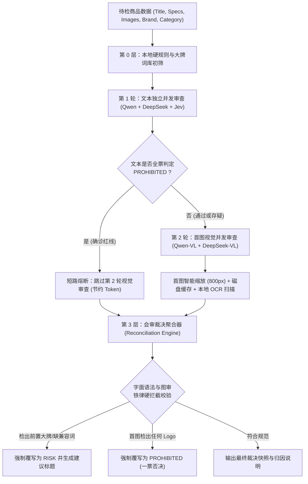

# 跨境电商跟品侵权违规分析系统 - 核心逻辑与技术复现指南

> **适用场景**：跨境电商（如 Makro、Takealot、Amazon、Walmart、Shopee 等）跟卖/跟品（Piggyback）自动化选品、自建 Listing 刊登前的知识产权（IP）合规质检、侵权风控与首图违规拦截。  
> **编写目标**：本指南全面剖析系统的三 AI 交叉会审架构、知识产权判别规则、首图 OCR 镭雕排查、标题合规重构算法以及工程化防漏判机制，供研发团队在全新项目中完整复现。

---

## 目录
1. [系统总体架构与风控原则](#一系统总体架构与风控原则)
2. [核心风控业务铁律（知识产权 + 平台规则）](#二核心风控业务铁律)
3. [多 AI 交叉会审与分流流水线设计](#三多-ai-交叉会审与分流流水线设计)
4. [Prompt 提示词工程与结构化解析](#四prompt-提示词工程与结构化解析)
5. [首图视觉多模态排查与五金镭雕 OCR](#五首图视觉多模态排查与五金镭雕-ocr)
6. [仲裁与分歧裁决引擎 (Reconciliation Engine)](#六仲裁与分歧裁决引擎-reconciliation-engine)
7. [违规配件标题智能重构算法](#七违规配件标题智能重构算法)
8. [数据库模型与数据字典](#八数据库模型与数据字典)
9. [新项目复现落地步骤清单 (Step-by-Step)](#九新项目复现落地步骤清单)

---

## 一、系统总体架构与风控原则

### 1. 核心设计原则
1. **“宁可杀错，不可放过” (Zero-Tolerance False Negative)**：  
   跨境电商平台（尤其是沃尔玛旗下的 Makro 或亚马逊）对侵权封店极严。一个侵权产品上线可能导致整个店铺被封、资金冻结。因此，质检系统宁可将轻微存疑标记为 `RISK` 交由人工复核，也绝不允许静默放行侵权品。
2. **三 AI 交叉会审 (3-AI Consensus & Arbitration)**：  
   结合 **通义千问 (Qwen-Plus/VL)** 的中文语义理解与多模态能力、**DeepSeek (DeepSeek-Chat/Flash)** 的高性价比与深度逻辑推理，以及 **Jev (TypeSafe AI)** 的亚秒级强类型决策引擎，形成三方会审机制。
3. **分层短路熔断 (Early-Exit Short-Circuiting)**：  
   先以极低成本跑本地规则库和第一轮文本审计；若文本已全票确认为不可逆违规（如受保护整机、违禁品），**立即短路跳过第二轮昂贵的多模态视觉审计**，节约 100% 图审 Token。
4. **异常绝不能默认 SAFE**：  
   网络超时、接口限流（429）、图片下载失败、JSON 格式截断等任何系统异常，**强制兜底标记为 `RISK`**，阻断未经质检的数据静默入库。

### 2. 质检评级定义
| 风险等级 | 标识 | 业务含义与平台动作 |
| :--- | :---: | :--- |
| **`SAFE`** | 🟢 合规安全 | 纯中性通用白牌品、具有合法兼容语法的规范配件、首图无任何 Logo，系统允许一键全自动发布/上架。 |
| **`RISK`** | 🟡 黄线风险 | 缺少字面兼容连接词、第三方大牌前置修饰、首图下载超时未完成视觉排查、或多 AI 产生分歧，需要运营人工一键仲裁或采纳 AI 建议标题。 |
| **`PROHIBITED`** | 🔴 红线禁售 | 假冒知名品牌、侵权知名影视动漫 IP、首图附带原卖家品牌 Logo/五金镭雕、或者液体/粉末/纯电池等航空禁运品，**强制一票否决禁止上架**。 |
| **`DISPUTED`** | 🟣 分歧待定 | 多 AI 模型结论完全相悖（如 SAFE vs PROHIBITED），交由系统仲裁日志，并提供人工终审。 |



---

## 二、核心风控业务铁律

新项目复现时，**必须在代码中严格硬编码以下五大铁律**：

### 铁律 1：知名品牌与奢侈品“零容忍”
* **国际顶级奢侈品**（Chanel, Gucci, LV, Hermes, Prada, Dior, YSL, Rolex 等）：  
  严禁任何形式的售卖、挂靠或修饰，直接判定 `PROHIBITED`。
* **知名整机大牌**（Apple, Sony, Dyson, Nintendo, Samsung, Makita, Milwaukee, Ford, BMW, Nike, Lego 等）：  
  未经官方品牌授权，绝不能以自有品牌（如 Beishi）作为前缀去卖品牌整机，否则构成严重假冒侵权。

### 铁律 2：配件兼容语法的“字面量与位置铁律” (核心精髓)
在跨境电商中，销售第三方兼容配件（如手机壳、替换滤网、充电转接头、车载支架）是主要盈利模式，必须符合**合理使用（Fair Use）语法规范**：
1. **字面量真实性铁律**：  
   标题必须**真实且显式**包含英文兼容连接词：
   `Compatible with`, `Compatible for`, `Suitable for`, `Replacement for`, `Designed for`, `For use with`, `Fits`, `Fit for`, 独立介词 `For`。  
   *严禁大模型脑补隐含兼容语境；字面无上述连接词一律判为 `RISK`。*
2. **位置顺序铁律（大牌后置）**：  
   第三方受保护品牌**必须且只能出现在兼容连接词之后**！  
   - ❌ 违规（大牌前置修饰）：`Sony PS5 Wireless Controller Silicone Case`（判定为 `RISK`，涉嫌前置品牌侵权与假冒联名）
   - ✅ 合规（大牌后置兼容）：`Silicone Controller Protective Case Compatible with Sony PS5`（判定为 `SAFE`）
3. **消除重复介词**：  
   严禁出现 `For ... Compatible with ...` 双重介词叠加，影响搜索权重并引发合规歧义。

### 铁律 3：跟品平台的“卖家白牌豁免”规则
在 Makro / Takealot 等支持跟卖的平台上：
* 若原 Listing 的品牌为普通卖家自造商号/白牌（如 Generic, OEM, 或无知名度的自造拼音商标），**平台官方跟卖规则 100% 允许挂靠跟卖**。
* 此类商品在文本端判定为 `SAFE`，但系统需附带运营防守提示：*“发货时必须使用纯中性外包装，切勿印制原卖家私有品牌标志。”*

### 铁律 4：首图“零 Logo 绝缘”红线 (关键防线)
在跟卖场景下，商家虽然可以挂靠 Listing，但**如果原商品首图机身、包装或金属插头上带有原卖家的私有 Logo 或商标**：
* 你的仓库发货的是中性公模货，如果买家收到发现产品机身没有原图上的那个 Logo，或者印了不同的 Logo，买家会发起 **"Item not as described / Counterfeit"** 投诉，平台将直接封店罚款！
* **判定准则**：首图只要检出任何品牌 Trademark、卖家商号或五金激光镭雕（如金属接头上的文字），**不论是名牌还是白牌，一律判定为 `PROHIBITED`**，禁止跟品挂靠！仅完全中性无 Logo 的纯白底产品图才允许 `SAFE`。

### 铁律 5：航空物流禁运与平台特许资质
* **航空物理禁运**：液体、香水、精油、喷雾灌装物、易燃易爆化学品、纯电池、管制刀具，一律判定 `PROHIBITED`。
* **无线电限制**：蓝牙（Bluetooth）、Wi-Fi 射频发射设备在南非需 ICASA 无线电认证，普通跨境直发无法清关，需标记预警。
* **准入许可品类**：灭蚊灯、保鲜膜、空气清新剂等 Makro 特殊类目需额外资质预警。

---

## 三、多 AI 交叉会审与分流流水线设计

系统采用并发多线程架构，兼顾审查深度与极速时延：

```
                    ┌──> 线程 1: Qwen-Plus (通义千问文本风控)
                    │
输入商品数据 ───────┼──> 线程 2: DeepSeek-Chat / Flash (深度逻辑与违规推理)
(Title/Brand/Specs) │
                    └──> 线程 3: Jev-Latest (TypeSafe 亚秒级决策与品牌形态分类)
                                          │
                                          ▼
                               第一轮聚合与短路判定
                                          │
               ┌──────────────────────────┴──────────────────────────┐
               │ 达成全票 PROHIBITED                                 │ 存在 SAFE 或 RISK
               ▼                                                     ▼
        【短路熔断】                                    并发下载首图 + 本地磁盘缓存
  跳过昂贵的第二轮视觉图审                                      + 等比缩放 (800px)
   (节约 100% 视觉 Token)                                            │
               │                                   ┌─────────────────┴─────────────────┐
               │                                   ▼                                   ▼
               │                          线程 1: Qwen-VL                     线程 2: DeepSeek-VL
               │                          (主图视觉多模态)                    (全域OCR与五金镭雕)
               │                                   │                                   │
               └───────────────────────────────────┼───────────────────────────────────┘
                                                   ▼
                                  【终审聚合器 Reconciliation Engine】
                                        结合字面规则与归因分析
                                                   │
                                                   ▼
                                         输出最终综合合规报告
```

---

## 四、Prompt 提示词工程与结构化解析

系统的提示词经过高密度精简，**降低约 65% Token 消耗，同时通过严格的规则约束消除大模型幻觉**。

### 1. 第一轮：标题文本风控 Prompt 模板
```text
跨境电商商品标题合规与知识产权风控审查。仅返回合法JSON，严禁输出非JSON内容。
【审查铁律】:
1. 知名大牌零容忍: 严查受保护大牌(Apple,Sony,Chevy,GMC,Ford,Toyota,Husqvarna,Nike,Dyson等)及动漫影视IP(Disney,Sanrio,Pokemon等)。区分语境: 规格词(1 piece)/功能词(frozen mold)合规。
2. 兼容配件规范:
   - 必须真实出现英文兼容词: 'Compatible with', 'For', 'Fits', 'Suitable for'，严禁脑补隐含语境；无字面兼容词一律判定 RISK (MISSING_COMPATIBILITY)；
   - 第三方大牌必须且仅出现在兼容连接词之后；严禁第三方大牌出现在连接词之前修饰商品（前置大牌侵权一律判定 RISK）；
   - 严禁第三方大牌直接紧跟自有品牌冒充联名；严禁连续堆砌>=3个大牌。
3. 卖家白牌豁免: Listing前缀品牌若为普通卖家商号/白牌(如Generic/OEM/自造拼音)，Makro跟品官方规则100%允许跟卖，此类判定 SAFE。
4. 违禁品排查: 严禁蓝牙/WiFi无线发射设备；严禁液体/香水/精油/易燃化学品跨境禁运品；区分实体工具/转接线/模具与灌装液体。
5. 评级: SAFE(合规通用品/白牌/规范配件), RISK(缺少字面兼容词/大牌前置修饰/过度堆砌), PROHIBITED(假冒大牌/受保护整机/违禁品)。

待审数据:
- 标题: {target_title}
- 授权自有品牌: {brand}
- 类目: {category}
- 描述: {clean_description}

返回JSON模板:
{
  "has_risk": false,
  "risk_level": "SAFE|RISK|PROHIBITED",
  "detected_brands_or_ips": ["识别到的品牌或IP"],
  "violation_type": "NONE|TRADEMARK|COPYRIGHT_IP|BRAND_SPAMMING|MISSING_COMPATIBILITY|PROHIBITED_TECH|PROHIBITED_LIQUID",
  "reasons": ["1.品牌属性说明", "2.兼容连接词语法与大牌位置说明", "3.平台跟品合规最终结论"],
  "summary": "1-2句精炼核心论证",
  "recommended_title": "合规英文建议标题"
}
```

### 2. 结构化 JSON 高容错解析器 (Robust Parser)
针对大模型输出时可能夹带 Markdown 标记（````json ... ````）、思考过程（`reasoning_content`）、甚至 Token 超限被截断导致括号不闭合的情况，代码实现 6 重容错兜底解析机制：

```python
@staticmethod
def _robust_parse_json(text: str) -> Optional[Dict[str, Any]]:
    """多重容错提取并解析 JSON 对象 (支持截断、额外 prose、嵌入 markdown 块)"""
    if not text or not text.strip():
        return None
    
    # 1. 直接整体解析
    try:
        d = json.loads(text.strip())
        if isinstance(d, dict): return d
    except Exception: pass

    # 2. 从第一个 '{' 尝试 raw_decode
    start_idx = text.find('{')
    decoder = json.JSONDecoder()
    while start_idx != -1:
        try:
            obj, _ = decoder.raw_decode(text[start_idx:])
            if isinstance(obj, dict): return obj
        except Exception: pass
        start_idx = text.find('{', start_idx + 1)

    # 3. 正则贪婪匹配
    json_match = re.search(r'\{.*\}', text, re.DOTALL)
    if json_match:
        try:
            d = json.loads(json_match.group())
            if isinstance(d, dict): return d
        except Exception: pass

    # 4. 截断容错修复：若由于 max_tokens 截断未闭合，自动修补常见末尾
    cleaned = text.strip()
    first_brace = cleaned.find('{')
    if first_brace != -1:
        snippet = cleaned[first_brace:]
        for suffix in ['"}', '"]}', '"]}}', '"} }', '}']:
            try:
                d = json.loads(snippet + suffix)
                if isinstance(d, dict) and ("risk_level" in d or "has_brand_logo" in d):
                    return d
            except Exception: continue

    # 5. 正则保底字段提取：即使 JSON 结构粉碎，依然稳健提取出判决结果
    if "risk_level" in text or "has_brand_logo" in text:
        extracted = {}
        rl_m = re.search(r'"risk_level"\s*:\s*"([A-Z_]+)"', text, re.I)
        if rl_m: extracted["risk_level"] = rl_m.group(1).upper()
        hr_m = re.search(r'"has_risk"\s*:\s*(true|false)', text, re.I)
        if hr_m: extracted["has_risk"] = hr_m.group(1).lower() == "true"
        sum_m = re.search(r'"summary"\s*:\s*"([^"\\]*(?:\\.[^"\\]*)*)', text)
        if sum_m: extracted["summary"] = sum_m.group(1).replace(r'\"', '"')
        if extracted.get("risk_level"): return extracted

    return None
```

---

## 五、首图视觉多模态排查与五金镭雕 OCR

很多商家在文字标题中写的是中性词，但在产品金属插头、包装盒或机身上**偷偷印制了商标**，导致被平台稽查封店。

### 1. 首图视觉 Prompt 模板
```text
电商首图合规与全域OCR字符审查{brand_hint}。仅返回合法JSON，严禁输出非JSON内容。
【审查铁律】:
1. 全域OCR与五金镭雕排查:
   - 全域扫描产品机身、包装、金属插头/五金接头(如USB-C/DP/HDMI等正反面)、线身胶圈，提取所有印刷英文字符(如ELFESOUL, 16K UHD, UGREEN等)；
   - 只要带有任何品牌商标Logo或商号文字(含卖家白牌/私牌)，一律判定 PROHIBITED；仅完全无文字Logo的纯中性产品图判定 SAFE。
2. 航空禁运排查: 严查液体、精油、香水、喷雾瓶灌装物、纯电池/易燃品，检出判定 PROHIBITED。
3. 评级: SAFE(纯中性无Logo白底图), RISK(字符模糊存疑), PROHIBITED(检出任何品牌Logo/插头镭雕商号/航空禁运品)。

返回JSON模板:
{
  "has_brand_logo": false,
  "detected_logos": ["提取到的品牌Logo或商号印刷词"],
  "detected_texts": ["画面上提取到的全部印刷文字清单"],
  "is_transport_prohibited": false,
  "prohibited_types": [],
  "risk_level": "SAFE|RISK|PROHIBITED",
  "summary": "指出在具体哪个部位识别到了什么文字及判定依据"
}
```

### 2. 视觉工程化三大性能优化
1. **智能等比缩放预处理 (800px LANCZOS)**：  
   原始图片通常高达 2000×2000，直接传给多模态 API 会消耗极其昂贵的大图 Token。系统在传输前使用 PIL 自动等比缩放至最大边长 800px，压缩比达到 JPEG 85%，**节约 45%~50% 视觉 Token，同时完全保留金属五金激光镭雕的清晰可辨度**。
2. **两级持久化缓存机制**：  
   - **L1 图片磁盘缓存**：按 URL 的 MD5 缓存二进制到 `.image_cache/`，跳过重复的网络拉取；
   - **L2 判决结果缓存**：当同一张首图被用于不同规格（变体）或重复选品时，直接从 `.verdict.json` 读取历史会审结果（0ms 响应，0 Token 消耗）。
3. **首图下载故障安全拦截**：  
   若图片 CDN 404 或网络阻断，系统**绝不放行**，直接判定为 `RISK`，在报告中打上红标 `【首图下载异常】首图下载失败，未完成视觉排查，需人工复核`。

---

## 六、仲裁与分歧裁决引擎 (Reconciliation Engine)

当多个 AI 对同一商品给出不同评级时，裁决引擎按以下逻辑进行裁决与细粒度归因分析：

### 1. 投票与加权仲裁逻辑
```python
# 1. 计算单模型综合评级 (文本与视觉取更高风险者)
qwen_overall = get_higher_risk(qwen_text_level, qwen_img_level)
deepseek_overall = get_higher_risk(deepseek_text_level, deepseek_img_level)

# 2. 三 AI 交叉裁决
if qwen_overall == deepseek_overall == jev_level:
    final_status = qwen_overall
    consensus_ratio = "3:0"  # 全票共识
elif qwen_overall == deepseek_overall:
    # 检查 Jev 安全一票否决：若 LLM 判安全，但 Jev 极高置信度 (score >= 0.85) 判 PROHIBITED
    if qwen_overall == "SAFE" and jev_level == "PROHIBITED" and jev_score >= 0.85:
        final_status = "PROHIBITED"
        reconciliation_summary = f"Jev 高确信检出高危侵权 (违规分: {jev_score:.2f})，触发一票阻断安全防护"
    else:
        final_status = qwen_overall
        consensus_ratio = "2:1"  # 多数胜出
elif qwen_overall == jev_level:
    # Qwen 与 Jev 一致，Jev 作为独立裁判打破 DeepSeek 平局
    final_status = qwen_overall
    consensus_ratio = "2:1"
elif deepseek_overall == jev_level:
    # DeepSeek 与 Jev 一致，Jev 作为独立裁判打破 Qwen 平局
    final_status = deepseek_overall
    consensus_ratio = "2:1"
else:
    # 三方完全相悖 (SAFE / RISK / PROHIBITED) -> 进入分歧待仲裁
    final_status = "DISPUTED"
    consensus_ratio = "DISPUTED"
```

### 2. 裁决后的“铁律硬拦截”覆写 (Hard Rules Post-Override)
在 AI 输出结论后，系统依然会通过硬规则代码对结论做最后一道严格审校：
1. **图审含 Logo 一票拦截**：  
   只要 `image_logos` 不为空或视觉模型标记了 `has_brand_logo=True`，**无条件强制覆写为 `PROHIBITED`**。
2. **缺兼容词 / 前置大牌硬拦截**：  
   扫描标题是否包含受保护大牌词。如果存在大牌，但标题没有合规兼容词，或者大牌出现在首个兼容词之前，**无条件强制将 `SAFE` 覆写为 `RISK`**，并自动触发标题合规重构。

---

## 七、违规配件标题智能重构算法

当商品因“缺少兼容连接词”或“前置大牌侵权”被拦截时，系统内置了强大的合规标题重构器（`reconstruct_accessory_title`），能自动将违规标题转化为平台合规标题：

### 1. 重构算法的核心步骤
```
原始标题: "Sony PS5 Slim Controller Charging Station with Fast Dual Ports"
                                │
                                ▼
步骤 1: 提取精确目标设备型号 (Device Model)
        匹配得到: "PlayStation 5 Slim" (绝不丢失具体机型代际)
                                │
                                ▼
步骤 2: 剥离并净化核心配件品名 (Sanitize Core Name)
        从核心品名中剔除第三方品牌 "Sony", "PS5", "Slim" 等，
        保留核心配件属性: "Controller Charging Station with Fast Dual Ports"
                                │
                                ▼
步骤 3: 语法规范装配 (Brand + Clean Core + Compatible with + Device Model)
        组装为: "Beishi Controller Charging Station with Fast Dual Ports Compatible with PlayStation 5 Slim"
                                │
                                ▼
步骤 4: 单词边界安全截断 (Word-Boundary Truncate)
        在最大 120 字符限制内，寻找最近的空格或分隔符截断，绝不切断单词。
```

### 2. 核心重构代码实现
```python
def reconstruct_accessory_title(
    makro_title: str,
    raw_title: str,
    target_brand: str = "Beishi",
    nature: str = "COMPATIBLE_ACCESSORY",
    target_famous: str = "NONE",
    specs: Any = None,
    vertical: str = "",
    max_len: int = 120
) -> str:
    full_text = f"{raw_title} {makro_title}".lower()
    
    # 1. 提取目标设备型号 (如 iPhone 15 Pro Max, Dyson V11, PS5 Slim)
    device_model = extract_device_model(raw_title, specs=specs, category=vertical) or \
                   extract_device_model(makro_title, specs=specs, category=vertical)
    target_ref = device_model or (target_famous if target_famous != "NONE" else "")

    # 2. 净化核心配件品名 (剔除核心词中的第三方大牌孤立词，防止 Compatible with 之前裸露大牌)
    cleaned_core = sanitize_accessory_core_name(
        makro_title,
        target_brand=target_brand,
        device_model=device_model,
        vertical=vertical
    )

    # 3. 结构化装配
    final_title = f"{cleaned_core} Compatible with {target_ref}".strip()

    # 4. 单词边界安全截断 (max_len 字符)
    return truncate_title_safely(final_title, max_len=max_len)
```

---

## 八、数据库模型与数据字典

### 1. 跟品合规字段定义 (`makro_piggyback_items`)
```python
class MakroPiggybackItem(Base):
    __tablename__ = "makro_piggyback_items"

    id = Column(Integer, primary_key=True)
    title = Column(String(500), nullable=False)
    brand = Column(String(100), nullable=True)
    image_url = Column(Text, nullable=True)

    # 核心质检状态:
    # PENDING_CHECK (待检测), SAFE (合规安全), RISK (黄线风险), PROHIBITED (红线禁售), DISPUTED (分歧待定)
    compliance_status = Column(String(50), default="PENDING_CHECK", index=True)
    
    # 结构化快照: 存储双 AI 与 Jev 的完整诊断快照、违规归因、建议标题
    compliance_details = Column(Text, nullable=True)
```

### 2. 人工仲裁与语料闭环日志表 (`compliance_arbitration_logs`)
当运营人员对 `DISPUTED` 或存疑商品进行人工终审裁决时，系统自动沉淀为语料：
```python
class ComplianceArbitrationLog(Base):
    __tablename__ = "compliance_arbitration_logs"

    id = Column(Integer, primary_key=True)
    product_id = Column(Integer, nullable=False, index=True)
    
    takealot_title = Column(String(500))
    makro_title = Column(String(500))
    brand = Column(String(100))
    image_url = Column(String(1000))
    
    # 双 AI 独立诊断快照
    qwen_verdict = Column(Text)
    deepseek_verdict = Column(Text)
    
    # 人工终审结果: SAFE / RISK / PROHIBITED
    human_verdict = Column(String(50), nullable=False)
    
    # 自动归因标注: 
    # QWEN_FALSE_POSITIVE, DEEPSEEK_FALSE_POSITIVE, QWEN_FALSE_NEGATIVE, CONSENSUS_AFFIRMED 等
    error_attribution = Column(String(50), index=True)
    human_notes = Column(Text)
    created_at = Column(DateTime, default=datetime.now)
```
*注：系统每次启动或执行质检时，会自动从该表提取最新的 4 条高质量人工裁决记录作为动态 Few-Shot 注入 Prompt，使系统越用越聪明。*

---

## 九、新项目复现落地步骤清单 (Step-by-Step)

若要在全新的项目中从零实现该功能，请按以下阶段执行：

### 阶段 1：依赖与品牌规则库准备
1. 安装核心依赖：
   ```bash
   pip install openai requests pillow urllib3 sqlalchemy
   ```
2. 移植字典常量文件：
   - 创建 `brands.py`：包含 `LUXURY_BRANDS`（奢侈品库）、`FAMOUS_BRANDS`（数码/汽配/机械知名大牌库）、`ACCESSORY_KEYWORDS`（配件特征词）、`COMPATIBILITY_KEYWORDS`（合格兼容连接词）。
   - 创建 `protected_ips.py`：包含知名影视、动漫、游戏 IP 词库（Disney, Marvel, Pokemon 等）。

### 阶段 2：视觉与图片缓存基建
1. 创建持久化图片缓存机制：本地建立 `.image_cache/` 目录。
2. 配置带连接池与重试的 HTTP Session（`requests.adapters.HTTPAdapter`），支持 3 次重试与指数退避。
3. 编写图片预处理函数：等比缩放至最大边长 800px，JPEG 质量 85%，转为 Base64 Data URI。

### 阶段 3：多 AI 服务类封装 (`ComplianceService`)
1. 初始化 `OpenAI` 客户端接入通义千问（DashScope API）与 DeepSeek 官方 API（`https://api.deepseek.com`）。
2. 实现 `_run_round1_text_audit`：构建精简提示词，通过 `ThreadPoolExecutor` 并发调用 Qwen 与 DeepSeek 文本风控。
3. 实现 `_run_round2_vision_audit`：构建五金镭雕与全域 OCR 提示词，并发调用 Qwen-VL 与 DeepSeek-VL。
4. 编写 `_robust_parse_json`：具备正则修补与括号自动闭合能力的鲁棒解析器。

### 阶段 4：仲裁聚合器与硬拦截覆写
1. 实现 `_reconcile_dual_verdicts`：
   - 比较双方评级，计算共识比例；
   - 执行铁律硬拦截（首图 Logo 一票拦截、第三方品牌前置裸露拦截、缺失兼容连接词拦截）；
   - 生成细粒度分歧归因字典（`dispute_root_cause`）。

### 阶段 5：标题合规重构器
1. 实现 `extract_device_model`：通过正则从标题与规格中提取具体设备型号。
2. 实现 `sanitize_accessory_core_name`：安全剥离前置侵权大牌词。
3. 实现 `reconstruct_accessory_title`：装配规范的 `[Brand] [Core] Compatible with [Device]` 标题并按单词边界安全截断。

### 阶段 6：接口与数据库持久化
1. 在数据表（如 `products` 或 `piggyback_items`）中增加 `compliance_status` 和 `compliance_details` 字段。
2. 在选品采集/刊登流水线中嵌入检测调用：若判定为 `PROHIBITED`，系统禁止勾选发布；若为 `RISK`，前端高亮提示并展示推荐修改标题。

---

*文档编写完成，可直接分发给开发团队作为系统架构与功能复现的技术规格说明书 (Tech Spec)。*
